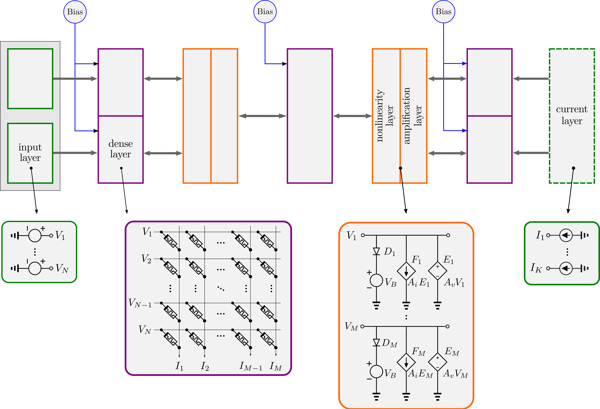

# EBANA

EBANA is a Python framework for training analog neural networks with Equilibrium
Propagation. The network is an actual circuit (crossbars of conductances,
diodes, amplifiers, sources) and it is trained by simulating that circuit in
ngspice, so what you train is what you would build. It was first presented in
[Frontiers in Computational
Neuroscience](https://www.frontiersin.org/journals/computational-neuroscience/articles/10.3389/fncom.2023.1114651/full).



A model is written like a Keras model, except that every layer is a piece of
circuit. Inputs are voltage sources, a `Dense` layer is a crossbar of resistors
whose conductances are the weights, and nonlinearities come from diodes and
bidirectional amplifiers. Each output is read as a node voltage and nudged with
a current source during training.

```python
xp = Input("xp", 4)
xn = Input("xn", 4)
b1 = Bias("b1", [1.0])
j1 = Concatenate("j1")([xp, xn, b1])
d1 = Dense("d1", 10, initializer=init, lr=1e-8)(j1)
a1 = Diode("a1", "down", model=IdealDiode(vth=0.15))(d1)
g1 = Amplifier("g1", gain=4)(a1)
d2 = Dense("d2", 6, initializer=init, lr=1e-9)(g1)
out = CurrentOutput("out", readout=Differential())(d2)

model = Model(outputs=[out])
history = model.fit(
    train_data=loader,
    epochs=40,
    optimizer=SGD(model),
    loss=CrossEntropy(),
    algorithm=EquilibriumPropagation(beta=2e-9),
    workers=8,
)
```

The physics lives in small classes (devices and element models), not in the
layers, so trying a new weight device or nonlinearity usually means writing one
class and passing it to an existing layer. The same goes for learning
algorithms, callbacks and what gets recorded during training.

The docs cover [building models](docs/building_models.md),
[training](docs/training.md) and [extending the framework](docs/extending.md).
The [examples](examples/simple) (logic gates, Iris, MNIST with a dense and a
locally connected layer) are the quickest way to see everything used together.

## Installation

EBANA needs ngspice built as a shared library. On Debian or Ubuntu:

```bash
sudo apt install ngspice libngspice0 libngspice0-dev
```

Then install EBANA, which pulls in
[PyCircuitSim](https://github.com/medwatt/PyCircuitSim) for talking to ngspice:

```bash
git clone https://github.com/mawatfa/ebana.git
cd ebana
pip install -e ".[examples]"
```

The `examples` extra adds scikit-learn and optuna, which only the examples use.

## Citation

If EBANA is useful in your research, I would appreciate a citation of the
[paper](https://www.frontiersin.org/journals/computational-neuroscience/articles/10.3389/fncom.2023.1114651/full).

For more on Equilibrium Propagation itself, the original paper is
[Scellier and Bengio (2017)](https://arxiv.org/abs/1602.05179).
